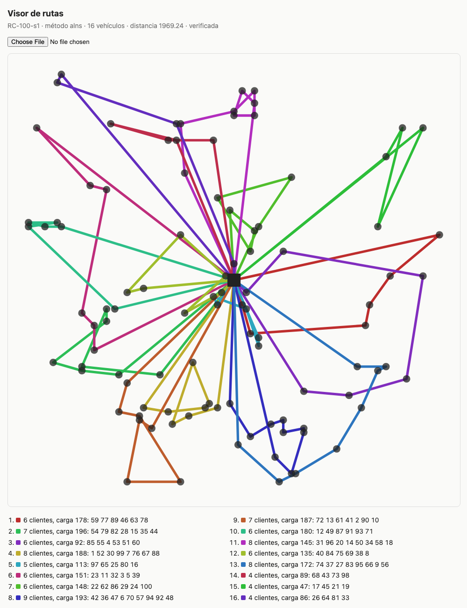

# ruteo-vehiculos

Solver de ruteo de vehículos con capacidad y ventanas de tiempo (CVRPTW) en
TypeScript, sin dependencias de runtime.

## El problema

Una flota de vehículos iguales sale de un depósito, atiende a cada cliente
exactamente una vez y vuelve. Cada vehículo tiene una capacidad, cada cliente
una demanda, un tiempo de servicio y una ventana `[inicio, fin]`: el servicio
debe empezar dentro de ella (llegar antes obliga a esperar; llegar después no
se permite). El depósito también tiene ventana, que fija el horizonte. El
objetivo es el de la literatura de Solomon: primero minimizar vehículos y,
con esos, la distancia total.

## Diseño

```
src/
  instancia.ts         modelo, matriz de distancias euclidianas (sin redondear)
  solomon.ts           lector y escritor del formato de Solomon
  generador.ts         instancias tipo R, C y RC con semilla
  segmento.ts          evaluación incremental de ventanas (prefijos y sufijos)
  verificador.ts       verificador independiente de soluciones
  construccion/        ahorros de Clarke-Wright, inserción I1 de Solomon
  mejora/              búsqueda local y ALNS
  exacto.ts            óptimo por fuerza bruta (hasta ~8 clientes)
  solver.ts, cli.ts, benchmark.ts
docs/visor.html        visor estático en SVG de una solución JSON
```

**Construcción.** Ahorros de Clarke y Wright en versión paralela, probando las
dos orientaciones de cada fusión porque con ventanas el orden importa. Inserción
I1 de Solomon (1987): semilla más lejana del depósito, criterio c1 con distancia
y atraso del siguiente cliente, c2 = λ·d0u − c1; se corre con una grilla chica
de parámetros y se queda la mejor, como hizo Solomon.

**Evaluación incremental.** Cada tramo de ruta se resume en duración, violación
acumulada, primer y último instante de comienzo, carga y distancia, y dos tramos
se concatenan en O(1) (Vidal et al., 2013). El "último instante de comienzo" es
la holgura hacia adelante de Savelsbergh generalizada: cuánto se puede atrasar
el tramo sin romper ninguna ventana posterior. Con prefijos y sufijos
precalculados por ruta, un movimiento entre rutas se evalúa sin volver a
simularlas.

**Búsqueda local.** Primera mejora sobre 2-opt y Or-opt dentro de la ruta, y
relocate (tramos de 1 a 3), swap / cross-exchange (tramos de hasta 3 por lado)
y 2-opt* entre rutas. Solo aplica movimientos factibles que bajan el costo
estrictamente; vaciar una ruta gana el peso de un vehículo.

**Metaheurística: ALNS** (Ropke y Pisinger, 2006). Destrucción aleatoria, peor
costo, relacionada (Shaw: cercanía en el plano y en la ventana) y por ruta
completa, que es la que empuja a bajar vehículos. Reparación greedy y regret-2.
Pesos adaptativos por ruleta, aceptación por recocido simulado y búsqueda local
completa sobre cada nuevo mejor global. Se eligió ALNS antes que tabú porque
los operadores de ruta completa atacan directamente el primer criterio del
objetivo.

**Verificador independiente.** No usa la matriz de distancias ni los
segmentos: recalcula desde las coordenadas simulando cada ruta. Comprueba que
cada cliente se visite una vez, la capacidad, las ventanas, la vuelta al
depósito y el tope de vehículos. Todas las pruebas, la CLI y el benchmark pasan
sus resultados por él; una solución inválida hace fallar la CLI con código 1.

## Instancias

Las instancias oficiales de Solomon (C1, C2, R1, R2, RC1, RC2) circulan
libremente para uso académico, pero no encontré una licencia explícita que
permita redistribuirlas, así que **el repo no las incluye**. En su lugar trae
un generador con semilla que imita las tres familias (uniforme, en cúmulos y
mixta) y garantiza que cada cliente sea servible con una ruta propia.

Las oficiales se bajan de la página de Marius Solomon
(`http://web.cba.neu.edu/~msolomon/problems.htm`) o de la de SINTEF sobre
VRPTW (`https://www.sintef.no/projectweb/top/vrptw/`), que además publica los
mejores conocidos. El lector acepta ese formato tal cual:

```
node dist/cli.js resolver C101.txt --metodo alns --iteraciones 5000
```

Por la misma razón el benchmark **no** compara contra mejores conocidos
publicados: no aplican a instancias generadas, y no quise copiar valores que no
pude verificar contra los archivos. La comparación que sí se hace es contra el
óptimo exacto en instancias chicas.

## Uso

Requiere Node 24.

```
npm install
npm run build
node dist/cli.js generar --familia C --clientes 25 --semilla 7 > c25.txt
node dist/cli.js resolver c25.txt --metodo alns --salida solucion.json
npm run benchmark      # ITERACIONES=… para cambiar el presupuesto del ALNS
npm run ejemplo        # regenera docs/ejemplo.html e instancias/RC-100-s1.txt
npm test
```

Salida real de la CLI sobre la instancia generada `C-25-s7`, con cada método:

```
C-25-s7  método=ahorros  vehículos=8  distancia=695.86  válida=true  tiempo=0.00 s
C-25-s7  método=insercion  vehículos=6  distancia=638.56  válida=true  tiempo=0.00 s
C-25-s7  método=local  vehículos=6  distancia=611.77  válida=true  tiempo=0.02 s
C-25-s7  método=alns  vehículos=6  distancia=611.77  válida=true  tiempo=0.09 s
```

Como biblioteca:

```ts
import { parsearSolomon, resolver, verificar } from "ruteo-vehiculos";
const inst = parsearSolomon(texto);
const sol = resolver(inst, { metodo: "alns", iteraciones: 5000, semilla: 1 });
console.log(verificar(inst, sol)); // { valida, errores, distancia, vehiculos }
```

## Benchmark

`npm run benchmark` en un Apple M1 Pro. Reproducible: misma semilla,
mismos números; los tiempos varían con la máquina.

Benchmark: ALNS con 5000 iteraciones, semilla 1, Node v24.11.1

| instancia | ahorros | I1 | búsqueda local | ALNS | tiempo ALNS |
|---|---|---|---|---|---|
| R-25-s1 | 9 / 998.5 | 8 / 952.8 | 8 / 909.4 | 8 / 909.4 | 0.17 s |
| C-25-s1 | 7 / 654.3 | 5 / 581.4 | 5 / 526.0 | 5 / 526.0 | 0.16 s |
| RC-25-s1 | 8 / 899.2 | 7 / 854.4 | 7 / 830.0 | 6 / 846.8 | 0.15 s |
| R-100-s1 | 24 / 2472.1 | 19 / 2368.7 | 19 / 2196.6 | 17 / 2115.0 | 1.86 s |
| C-100-s1 | 22 / 1802.8 | 14 / 1715.6 | 14 / 1460.1 | 13 / 1391.9 | 2.06 s |
| RC-100-s1 | 26 / 2402.4 | 17 / 2159.9 | 17 / 1981.3 | 16 / 1944.4 | 1.88 s |

Celdas: vehículos / distancia. Objetivo jerárquico: primero vehículos.

Contra el óptimo exacto (fuerza bruta), 8 clientes:

| instancia | óptimo | ALNS | brecha |
|---|---|---|---|
| R-8-s1 | 3 / 339.38 | 3 / 339.38 | 0.00 % |
| R-8-s2 | 6 / 647.22 | 6 / 647.22 | 0.00 % |
| R-8-s3 | 3 / 360.09 | 3 / 360.09 | 0.00 % |
| R-8-s4 | 5 / 459.64 | 5 / 459.64 | 0.00 % |
| C-8-s1 | 3 / 362.58 | 3 / 362.58 | 0.00 % |
| C-8-s2 | 3 / 179.12 | 3 / 179.12 | 0.00 % |
| C-8-s3 | 6 / 462.64 | 6 / 462.64 | 0.00 % |
| C-8-s4 | 4 / 327.07 | 4 / 327.07 | 0.00 % |
| RC-8-s1 | 3 / 490.05 | 3 / 490.05 | 0.00 % |
| RC-8-s2 | 5 / 402.75 | 5 / 402.75 | 0.00 % |
| RC-8-s3 | 4 / 376.83 | 4 / 376.83 | 0.00 % |
| RC-8-s4 | 4 / 366.36 | 4 / 366.36 | 0.00 % |

Óptimo alcanzado en 12 de 12.

## Visualización

`docs/visor.html` es una página estática, sin framework, que lee el JSON de
`--salida` y dibuja las rutas en SVG; pasar el mouse por una ruta de la lista
la resalta. `docs/ejemplo.html` trae incrustada la solución de `RC-100-s1` y
se abre sin servidor.



## Pruebas

`npm test` corre 27 pruebas de conducta:

- el verificador rechaza soluciones malas: sobrecarga, ventanas violadas,
  clientes repetidos, faltantes o inexistentes, vuelta tardía, exceso de
  vehículos, y mutaciones de una solución real;
- la concatenación de segmentos coincide con una simulación directa en miles de
  rutas al azar (la prueba exige que haya casos factibles e infactibles), y da
  lo mismo asociarla por la izquierda o por la derecha;
- la búsqueda local nunca empeora ni rompe la factibilidad, con todos los
  operadores juntos y con cada uno por separado (y cada uno mejora al menos
  una instancia, para que la prueba no pase en vacío);
- el óptimo por fuerza bruta coincide con una enumeración ingenua de
  permutaciones y cortes, y el solver alcanza ese óptimo en instancias de 6 y
  7 clientes;
- el ALNS es determinista con la misma semilla.

Cada archivo de prueba lleva al inicio las mutaciones que se introdujeron a mano
para comprobar que las pruebas caen, y cuántas cayeron. Una de ellas (anular la
espera en la concatenación) no tumbó ninguna prueba, y está documentado por qué:
es una mutación equivalente en este modelo.

## Limitaciones

- Sin las instancias oficiales en el repo no hay comparación con los mejores
  conocidos. En las generadas el ALNS es un buen solver de propósito general,
  no uno competitivo con el estado del arte (HGS, por ejemplo).
- Las distancias son euclidianas sin redondear. Parte de la literatura trunca a
  un decimal o redondea; los números no son comparables entre convenciones.
- La búsqueda local evalúa los movimientos dentro de una ruta simulándola
  entera; solo los movimientos entre rutas usan la evaluación en O(1).
- No hay tope de duración por ruta, flota heterogénea ni múltiples depósitos.
- El óptimo exacto es fuerza bruta: sirve hasta unos 8 o 9 clientes.
- La captura de `docs/ejemplo.png` se tomó con Chromium en modo claro.

## Referencias

- Clarke, G. y Wright, J. W. (1964). Scheduling of vehicles from a central depot to a number of delivery points. *Operations Research* 12(4).
- Solomon, M. M. (1987). Algorithms for the vehicle routing and scheduling problems with time window constraints. *Operations Research* 35(2).
- Savelsbergh, M. W. P. (1992). The vehicle routing problem with time windows: minimizing route duration. *ORSA Journal on Computing* 4(2).
- Ropke, S. y Pisinger, D. (2006). An adaptive large neighborhood search heuristic for the pickup and delivery problem with time windows. *Transportation Science* 40(4).
- Vidal, T., Crainic, T. G., Gendreau, M. y Prins, C. (2013). A hybrid genetic algorithm with adaptive diversity management for a large class of vehicle routing problems with time-windows. *Computers & Operations Research* 40(1).

## Licencia

MIT.
